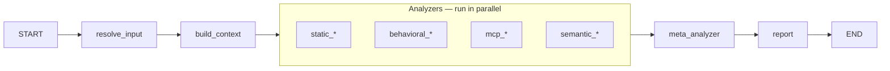

# Skillspector Development Guide

This guide helps developers understand, run, test, and extend the LangGraph-based skillspector workflow.

---

## 1. Overview

**skillspector** is a LangGraph workflow that scans a skill directory (or zip) and produces a SARIF 2.1.0 report, risk score, and formatted output (terminal, JSON, Markdown, or SARIF). It is the graph/engine for security analysis of AI agent skills.

**Entry points** are:

- **CLI** — run `skillspector scan <path-or-url>` (supports Git URL, file URL, .zip, .md file, or directory). Use `--format terminal|json|markdown|sarif`, `--output FILE`, `--no-llm`. See `skillspector --help`.
- **Programmatic** — `from skillspector import graph` and call `graph.invoke(...)` or `graph.stream(...)`.

**Data flow (one sentence):** `resolve_input` (input_path or skill_path → `skill_path`, optional `temp_dir_for_cleanup`) → build context → parallel analyzers → meta_analyzer (LLM filter/enrich when `use_llm` is True) → report (SARIF + risk score + `report_body` from `output_format`). Caller cleans up `temp_dir_for_cleanup` after invoke when set.

---

## 2. Prerequisites and setup

Follow the [README development setup](../README.md#setup) for the canonical
prerequisites, clone, virtual environment, and dependency-installation recipe.
The supported Python range is defined in [pyproject.toml](../pyproject.toml).
All Makefile targets assume the virtual environment is already created and activated.

To observe this workflow with a coding agent, use the
[contributor onboarding check](validation/CONTRIBUTOR_ONBOARDING.md), which
records setup and check results separately from full PR validation.

- **Installation**: `make install` and `make install-dev` use **uv** if available (`uv sync` / `uv sync --all-extras`), otherwise **pip** (`pip install -e .` / `pip install -e ".[dev]"`).
- **Environment**: Export the variables used by your scan or load an optional `.env` file with `uv run --env-file .env`. Key variables:
  - **`SKILLSPECTOR_PROVIDER`** selects `openai` (default) or `openai_compatible`.
  - **`OPENAI_API_KEY`** configures OpenAI. **`OPENAI_BASE_URL`** can point to a compatible endpoint.
  - **`SKILLSPECTOR_COMPAT_API_KEY`** and **`SKILLSPECTOR_COMPAT_BASE_URL`** configure the dedicated compatible provider.
  - **`SKILLSPECTOR_MODEL`** overrides the provider's default. See the [LLM configuration examples](../README.md#llm-analysis).
  - **`SKILLSPECTOR_TEMPERATURE`** sets an optional sampling temperature from `0` to `1` for models that support it.
  - **`SKILLSPECTOR_SEED`** sets an optional integer sampling seed.

- **Logging**: Internal/operational logging uses the stdlib `logging` module. User-facing output (report body, errors, progress) uses Rich `console.print()`.
  - **Env**: `SKILLSPECTOR_LOG_LEVEL` (DEBUG, INFO, WARNING, ERROR). Default is `"WARNING"` (defined in [constants.py](../src/skillspector/constants.py)).
  - **CLI**: `--verbose` / `-V` sets internal logging to DEBUG for that run.
  - **In code**: `from skillspector.logging_config import get_logger; logger = get_logger(__name__)`.

---

## 3. Make targets

All targets assume the virtual environment is **already created and activated**. See [Makefile](../Makefile) for the full list.

| Target | Description |
|--------|-------------|
| `make help` | Show available targets |
| `make install` | Install the package in production mode |
| `make install-dev` | Install the package with development dependencies |
| `make test-unit` | Initial test selection: excludes `integration` and `provider` markers |
| `make test-integration` | Full-graph integration tests; may call a configured LLM provider |
| `make test` | Run `test-unit` and `test-integration`; the current contributor submission requirement |
| `make test-provider` | Live provider requests; see [provider prerequisites](#live-provider-tests) |
| `make test-cov` | The `test-unit` marker selection with coverage (HTML + terminal) |
| `make test-ci` | The `test-unit` marker selection with coverage (XML + terminal) |
| `make lint` | Check lint with Ruff |
| `make format-check` | Check formatting without editing files |
| `make format` | Apply Ruff lint fixes and formatting in place |
| `make clean` | Remove build artifacts and cache files |
| `make build` | Build the package |

---

## 4. Architecture and graph structure

### State

[state.py](../src/skillspector/state.py) defines **`SkillspectorState`** (TypedDict, `total=False`). Key fields:

| Field | Description |
|-------|-------------|
| `input_path` | Raw input (URL, zip path, file path, or directory); consumed by resolve_input |
| `skill_path` | Resolved local directory path (set by resolve_input) |
| `temp_dir_for_cleanup` | Set by resolve_input when URL/zip/file was resolved; caller must clean up after invoke |
| `zip_bytes`, `mode` | Optional zip input and scan mode |
| `components` | List of relative file paths in the skill |
| `file_cache` | Map of path → file contents |
| `inspection_ledger` | Structured evidence for files excluded, skipped, or failed during analysis; unsupported DSSE decoding is recorded as an `oms_signature` partial event; successfully projected bundles remain in analysis without a scope exclusion. |
| `ast_cache` | Map of path → AST representation (for future use) |
| `manifest`, `previous_manifest` | Parsed skill metadata (e.g. from SKILL.md) |
| `component_metadata` | List of dicts: path, type, lines, executable, size_bytes (from build_context) |
| `has_executable_scripts` | True if any component has executable extension (e.g. .py, .sh); used for risk multiplier |
| `output_format` | Requested report format: `terminal`, `json`, `markdown`, or `sarif` |
| `report_body` | Formatted report string (set by report node from `output_format`) |
| `use_llm` | When False, meta_analyzer skips LLM and uses fallback (e.g. for `--no-llm`) |
| `baseline` | Loaded `suppression.Baseline` (set by CLI/API from `--baseline`); report node drops matching findings before scoring |
| `show_suppressed` | When True, baseline-suppressed findings are listed in the report (still excluded from the risk score) |
| `suppressed_findings` | List of `SuppressedFinding` (finding + reason) produced by the report node |
| `findings` | All raw findings from analyzers (reducer: `operator.add`) |
| `filtered_findings` | Report-stage compatibility projection selected from `effective_finding_ids` |
| `model_config` | Optional model IDs per node (e.g. default, meta_analyzer) |
| `risk_severity` | Severity band from risk score: LOW, MEDIUM, HIGH, CRITICAL |
| `risk_recommendation` | SAFE, CAUTION, or DO_NOT_INSTALL (from report node) |
| `sarif_report` | Final SARIF 2.1.0 dict |
| `risk_score` | Numeric risk score (0–100) |

### Graph

The graph is built in [graph.py](../src/skillspector/graph.py) via **`create_graph()`** and exposed as **`graph`** from the package ([__init__.py](../src/skillspector/__init__.py)).

### Flow diagram



There are no conditional edges: after `resolve_input` → `build_context`, all analyzer nodes run in parallel (fan-out); they all feed into `meta_analyzer` (fan-in), then `report` → `END`.

### Nodes

| Node | Role | Source |
|------|------|--------|
| **resolve_input** | Consumes `input_path` or `skill_path`; resolves URLs/zips/files via InputHandler; sets `skill_path` and (when needed) `temp_dir_for_cleanup` | [resolve_input.py](../src/skillspector/nodes/resolve_input.py) |
| **build_context** | Reads `skill_path`, populates `components`, `file_cache`, `ast_cache`, `manifest`, `component_metadata`, `has_executable_scripts` | [build_context.py](../src/skillspector/nodes/build_context.py) |
| **Analyzers** | 22 nodes; each returns `AnalyzerNodeResponse` (list of `Finding`). State reducer appends to `findings`. | [nodes/analyzers/__init__.py](../src/skillspector/nodes/analyzers/__init__.py) (`ANALYZER_NODE_IDS`, `ANALYZER_NODES`) |
| **meta_analyzer** | Per-file LLM filter/enrich of canonical `findings`; emits ordered `effective_finding_ids` for report selection. One LLM call per file (or per chunk for oversized files); token budgets from `constants.py`; falls back when `use_llm` is False. | [meta_analyzer.py](../src/skillspector/nodes/meta_analyzer.py), [llm_analyzer_base.py](../src/skillspector/llm_analyzer_base.py) |
| **report** | Applies baseline suppression (`state["baseline"]`), then builds SARIF 2.1.0, computes `risk_score`, `risk_severity`, `risk_recommendation` from the non-suppressed findings; writes `report_body` from `output_format` (terminal/json/markdown/sarif) | [report.py](../src/skillspector/nodes/report.py) |

---

## 5. Package layout

| Path | Purpose |
|------|---------|
| **Root** | |
| `graph.py` | Builds and compiles the LangGraph workflow |
| `state.py` | `SkillspectorState`, `AnalyzerNodeResponse`, `MetaAnalyzerResponse` |
| `models.py` | `Finding`, `AnalyzerFinding`, `Location`, `Severity`, `AnalyzerPlugin` |
| `constants.py` | Env-driven config: inference URL, default model, `MODELS` dict, token budgets (`get_max_input_tokens`, `get_max_output_tokens`) |
| `llm_utils.py` | `chat_completion()` for OpenAI-compatible / NVIDIA Inference API |
| `cli.py` | Typer app: `scan` (with input resolution, `--format`, `--no-llm`), `--version` |
| `input_handler.py` | Resolves Git URL, file URL, .zip, single file, or directory to a local directory path |
| `suppression.py` | Baseline / false-positive suppression: `Baseline`, `SuppressionRule`, `load_baseline`, `partition_findings`, `finding_fingerprint`, `build_baseline_dict`; exact v2 fingerprints require the scanner version and source `file_cache` (see [SUPPRESSION.md](SUPPRESSION.md)) |
| `__init__.py` | Package version (from pyproject.toml via `importlib.metadata`) |
| `sarif_models.py` | SARIF 2.1.0 Pydantic models and `validate_sarif_report()` |
| **nodes/** | |
| `build_context.py` | Build-context node |
| `llm_analyzer_base.py` | Base LLM analyzer with per-file/per-chunk batching (`LLMAnalyzerBase`, `LLMMetaAnalyzer`, `Batch`) |
| `meta_analyzer.py` | Meta-analyzer node (uses `LLMMetaAnalyzer` for per-file LLM calls) |
| `report.py` | Report node |
| **nodes/analyzers/** | |
| `__init__.py` | Registry: `ANALYZER_NODE_IDS`, `ANALYZER_NODES` |
| `common.py` | Shared analyzer helpers (line/context extraction, AST name resolution) |
| `static_runner.py` | Runs static patterns; converts `AnalyzerFinding` → `Finding` |
| `pattern_defaults.py` | Shared pattern metadata (category, explanation, remediation) |
| `static_yara.py` | YARA-based static analyzer |
| `osv_client.py` | OSV.dev API client for live vulnerability lookups (SC4); batch queries with caching and fallback |
| `static_patterns_*.py` | 14 pattern-based analyzers (prompt_injection, data_exfiltration, anti_refusal, etc.) |
| `behavioral_ast.py` | AST-based behavioral analyzer (AST1–AST8): detects exec, eval, subprocess, os.system, compile, dynamic import/getattr, and dangerous execution chains |
| `behavioral_taint_tracking.py` | Taint-tracking behavioral analyzer (TT1–TT5): source→sink data-flow analysis over Python AST |
| `mcp_least_privilege.py`, `mcp_tool_poisoning.py` | MCP analyzers (LP1–LP4 least-privilege; TP1–TP4 tool poisoning) |
| `mcp_rug_pull.py` | MCP rug-pull analyzer (RP1–RP3): detects manifest/tool-definition changes between scans |
| `semantic_security_discovery.py`, `semantic_developer_intent.py`, `semantic_quality_policy.py` | Semantic (LLM) analyzers; emit findings only when `use_llm` is enabled |

---

## 6. Running the workflow

### CLI

After creating/activating the venv and running `make install-dev` (or `pip install -e ".[dev]"`), the **skillspector** CLI is available:

```bash
skillspector scan ./my-skill/                    # terminal output
skillspector scan ./my-skill/ --format json -o report.json
skillspector scan https://github.com/user/repo   # Git URL (clones to temp dir)
skillspector scan ./skill.zip --no-llm          # static analysis only
skillspector --version
```

The CLI passes `input_path` to the graph. The **resolve_input** node (using [input_handler.py](../src/skillspector/input_handler.py)) resolves Git URL, file URL, .zip, single .md file, or directory to a local directory and sets `skill_path` (and `temp_dir_for_cleanup` when a temp dir was created). The CLI cleans up `temp_dir_for_cleanup` after invoke. Exit code 1 if risk_score > 50; exit code 2 on error. See [Integrating SkillSpector](../README.md#integrating-skillspector) for the full exit-code and JSON contract.

### Programmatic

```python
from skillspector import graph

result = graph.invoke({
    "input_path": "/path/to/skill",  # or use "skill_path" for a local dir
    "output_format": "json",   # optional: terminal, json, markdown, sarif (default sarif)
    "use_llm": True,           # optional: False to skip LLM in meta_analyzer
})
# Or: graph.stream(...)
```

Optional state keys: `mode`, `model_config`, `output_format`, `use_llm`. The final report result includes canonical `findings`, the report-projected `filtered_findings`, `sarif_report`, `risk_score`, `risk_severity`, `risk_recommendation`, and `report_body` (formatted string for the requested `output_format`).

---

## 7. Testing

- **Location**:
  - [tests/unit/](../tests/unit/): `test_cli.py`, `test_input_handler.py`, `test_patterns.py`, `test_sarif.py`
  - [tests/integration/](../tests/integration/): `test_graph.py`, `test_graph_scanner.py`, `test_meta_analyzer_use_llm.py`
  - [tests/nodes/](../tests/nodes/): `test_build_context.py`, `test_resolve_input.py`, `test_report.py`, `test_llm_analyzer_base.py`
  - [tests/nodes/analyzers/](../tests/nodes/analyzers/): analyzer tests (`test_registry.py`, `test_static_patterns.py`)
- **Initial checks**: `make test-unit`, `make lint`, and `make format-check` after following the [canonical setup](../README.md#setup). The unit target excludes tests marked `integration` or `provider`; that selection is not the entire CI gate or a guarantee of network isolation.
- **Full contributor check**: `make test` runs unit and integration tests, as required by [CONTRIBUTING.md](../CONTRIBUTING.md#how-to-contribute). `make test-integration` invokes the full graph and may send test content to a configured LLM provider; review the environment and provider prerequisites before running it. The initial unit selection does not replace this requirement.
- **Coverage and live checks**: `make test-cov` and `make test-ci` use the same marker exclusions as `make test-unit`. `make test-provider` makes live requests and needs the corresponding [provider configuration](#live-provider-tests).
- **Key tests**: [test_graph.py](../tests/integration/test_graph.py) invokes the graph and asserts `findings`, `sarif_report`, `risk_score`, `report_body`; [test_input_handler.py](../tests/unit/test_input_handler.py) covers directory, zip, and single-file resolution; [test_resolve_input.py](../tests/nodes/test_resolve_input.py) covers the resolve_input node; [test_build_context.py](../tests/nodes/test_build_context.py) asserts `component_metadata` and `has_executable_scripts`.

### CI coverage: public GitHub and internal GitLab

SkillSpector uses its public GitHub Actions workflow as the contributor-facing
quality gate and runs an additional validation pipeline in NVIDIA's internal
GitLab. The two pipelines intentionally share the core checks, while each also
has checks suited to its environment.

| Check | Public GitHub CI | Internal GitLab CI |
|-------|------------------|--------------------|
| Trigger | Pull requests to `main` and pushes to `main` | Merge requests targeting `main` and pushes to the default branch |
| Runtime | Python 3.12 with `uv` on GitHub-hosted Ubuntu runners | Python 3.12 with `uv` in a container on internal Kubernetes runners |
| Lint and formatting | Ruff lint and format checks | The same Ruff lint and format checks |
| Unit tests | Non-integration, non-provider tests with coverage | The same unit-test set with Cobertura coverage artifacts |
| Integration tests | Not run | Full-graph integration suite; these tests may call configured LLM providers |
| Live provider tests | Not run | Optional manual test against OpenAI using a masked CI credential |
| Static analysis | OpenSSF Scorecard runs in a separate public workflow | SonarQube runs after unit tests and is currently non-blocking |
| Contribution policy | DCO sign-off check on pull requests | No separate DCO job |
| Automated review | No review bot job is defined in the workflow | CodeRabbit is connected through an external integration/webhook, not a runner job |

The internal pipeline therefore adds coverage for the full application flow,
live provider connectivity, and SonarQube analysis. Its default-branch pipeline
rechecks the exact commit that landed after a merge. Live provider testing is
manual so it only sends requests when a maintainer chooses to run it; missing
credentials produce a warning, while invalid credentials or provider failures
fail the corresponding test. SonarQube is informational today and does not
block a merge request.

---

## 8. Data models

- **Finding** ([models.py](../src/skillspector/models.py)): `rule_id`, `message`, `severity`, `confidence`, `file`, `start_line`, `end_line`, `category`, `pattern`, `finding`, `explanation`, `remediation`, `code_snippet`, `intent`, `tags`, `context`, `matched_text`. This is the type stored in state and used in SARIF and JSON report output.
- **AnalyzerFinding**: Analyzer-facing type with `Location` and `Severity` enum. Convert to `Finding` via [static_runner.analyzer_finding_to_finding](../src/skillspector/nodes/analyzers/static_runner.py) (or equivalent).
- **SARIF**: [sarif_models.py](../src/skillspector/sarif_models.py) provides Pydantic models for SARIF 2.1.0. The report node builds a `SarifLog` from its effective-ID-selected findings.

---

## 9. Adding or modifying analyzer nodes

### Registering an analyzer

1. Add the node id to **`ANALYZER_NODE_IDS`** and the implementation to **`ANALYZER_NODES`** in [nodes/analyzers/__init__.py](../src/skillspector/nodes/analyzers/__init__.py).
2. No change to [graph.py](../src/skillspector/graph.py) is required: edges from `build_context` to each analyzer and from each analyzer to `meta_analyzer` are added in a loop using `ANALYZER_NODE_IDS`.

### Node signature

- **Input**: `state: SkillspectorState` (or `dict[str, object]`).
- **Output**: **`AnalyzerNodeResponse`** — a dict with key `"findings"` and value `list[Finding]`.

### Static pattern analyzers

Use [static_runner.run_static_patterns](../src/skillspector/nodes/analyzers/static_runner.py) with one or more pattern modules. Each module must provide:

- **`analyze(content: str, file_path: str, file_type: str) -> list[AnalyzerFinding]`**

Use [pattern_defaults](../src/skillspector/nodes/analyzers/pattern_defaults.py) for category and remediation. Examples: [static_patterns_prompt_injection.py](../src/skillspector/nodes/analyzers/static_patterns_prompt_injection.py), [static_patterns_data_exfiltration.py](../src/skillspector/nodes/analyzers/static_patterns_data_exfiltration.py).

### Placeholder analyzers

Return `{"findings": []}`. All analyzer nodes are currently implemented; use this pattern for any new placeholder analyzer added before its detection logic lands. The LLM-backed semantic analyzers also return `{"findings": []}` when `use_llm` is False.

---

## 10. Environment and configuration

### .env

To use an environment file, copy [.env.example](../.env.example) to `.env` in the project root, set values as needed, and run `uv run --env-file .env skillspector scan <path>`.

| Variable | Description | Example |
|----------|-------------|---------|
| `SKILLSPECTOR_PROVIDER` | Active provider. Choose `openai` (default) or `openai_compatible`. | `openai_compatible` |
| `OPENAI_API_KEY` | Credential for `openai` and the fallback for an unconfigured `openai_compatible`. | `sk-...` |
| `OPENAI_BASE_URL` | Override the OpenAI endpoint (e.g. point at Ollama). | `http://localhost:11434/v1` |
| `SKILLSPECTOR_REASONING_EFFORT` | Optional reasoning effort passed to the endpoint. Unset or blank preserves the endpoint default. `gpt-6.1-sol` accepts only `low`, `medium`, `high`, `xhigh`, or `max`. Unsupported values for that model stop the scan before analysis (exit code 2). | `high` |
| `SKILLSPECTOR_OUTPUT_LANGUAGE` | Optional short, single-line language label (letters, numbers, spaces, `_`, or `-`; maximum 64 characters) for human-readable LLM finding text. Rule IDs, severity values, paths, code, and other machine-readable values remain unchanged. Unset, blank, or invalid values preserve the default output language. | `Japanese` |
| `SKILLSPECTOR_TEMPERATURE` | Optional sampling temperature from `0` to `1`. Unset or blank preserves the endpoint default. `gpt-6.1-sol` and Claude models from the Opus 4.7+, Sonnet 5, Fable 5, Mythos 5, and Haiku 5 families reject explicit temperature on these two provider routes. Static scans skip provider initialization and control validation. | `0` |
| `SKILLSPECTOR_SEED` | Optional signed 64-bit integer sampling seed. Endpoint and model support is best-effort. | `42` |
| `SKILLSPECTOR_COMPAT_API_KEY` | Credential for `SKILLSPECTOR_PROVIDER=openai_compatible`. | `...` |
| `SKILLSPECTOR_COMPAT_BASE_URL` | OpenAI-compatible endpoint base URL. | `https://api.groq.com/openai/v1` |
| `SKILLSPECTOR_COMPAT_HEADERS` | Optional JSON object with string header names and values for `openai_compatible`. Applies to sync and async requests; unset or blank adds no headers. Invalid configuration is rejected without exposing header values. May contain gateway API keys, so treat it as a secret. | `{"X-Tenant-ID":"my-tenant","X-API-Key":"gateway-key"}` |
| `SKILLSPECTOR_MODEL` | Override the active provider's bundled default model. | `gpt-5.2` |

### Live provider tests

Run `make test-provider openai` to test `https://api.openai.com/v1`.
The test requires `OPENAI_API_KEY` and uses the default OpenAI model
unless `SKILLSPECTOR_OPENAI_TEST_MODEL` is set. Without an API key, the
target warns and skips the live request. Run `make test-provider` for
the full provider test suite, including opt-in semantic evaluations.

### Constants, token budgets, and LLM

- **Constants** ([constants.py](../src/skillspector/constants.py)): `_SKILLSPECTOR_DEFAULT_MODEL`, `MODEL_CONFIG` (per-node model selection), `MAX_INPUT_TOKENS_PCT` (0.75), `DEFAULT_CONTEXT_LENGTH` (128k fallback).
  - **`get_max_input_tokens(model)`** — input budget per LLM request (75% of resolved context window).
  - **`get_max_output_tokens(model)`** — output budget per LLM request (min of 25% context, registry's `max_output_tokens` cap if set).
  - Batch budget overhead is computed per-prompt via `estimate_tokens(base_prompt)` rather than a fixed constant.
- **Providers** ([providers/](../src/skillspector/providers/)) resolve credentials and token budgets. Each provider bundles a `model_registry.yaml` and looks up model limits through [registry.py](../src/skillspector/providers/registry.py).
  - `openai/` is the default. It uses `OPENAI_API_KEY` and supports the `OPENAI_BASE_URL` override.
  - `openai_compatible/` uses `SKILLSPECTOR_COMPAT_API_KEY` and `SKILLSPECTOR_COMPAT_BASE_URL`, with optional gateway headers.
- **LLM calls** ([llm_utils.py](../src/skillspector/llm_utils.py)) use the active provider's OpenAI-protocol chat model. The output token cap comes from `get_max_output_tokens(model)` in `model_info`.
- **LLM analyzer base** ([llm_analyzer_base.py](../src/skillspector/llm_analyzer_base.py)): `LLMAnalyzerBase` provides per-file/per-chunk batching, token-budget-aware chunking, and a run loop for all LLM-based analyzers. `LLMMetaAnalyzer` extends it for filter/enrich (meta_analyzer node). Future semantic analyzers extend `LLMAnalyzerBase` for discovery mode.

---

## 11. Linting and formatting

- **Format**: `make format` — apply Ruff lint fixes and formatting in place.
- **Check formatting**: `make format-check` — check formatting without editing files.
- **Lint**: `make lint` — Ruff check.
- **Config**: [pyproject.toml](../pyproject.toml) (Ruff line-length 100, target Python 3.12).

---

## 12. Quick reference

| Task | Command or action |
|------|-------------------|
| **Get started** | Follow the [README development setup](../README.md#setup). Re-activate the virtual environment in each new terminal. |
| **Run workflow** | `skillspector scan <path>` for CLI or `graph.invoke({"input_path": "...", "output_format": "json"})` (or `skill_path`) programmatically |
| **Add analyzer** | Implement node returning `{"findings": list[Finding]}`, register in `nodes/analyzers/__init__.py` |
| **Initial checks** | `make test-unit`, `make lint`, `make format-check`; see [Testing](#7-testing) for scope |
| **Full contributor tests** | `make test` includes integration tests that may call a configured LLM provider; review [Testing](#7-testing) and provider prerequisites first |
